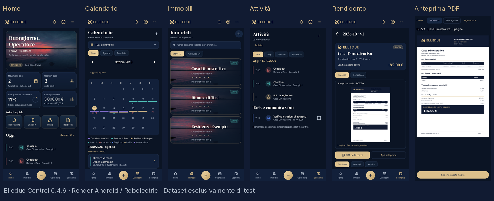

# Elledue Control 0.4.6 — redesign del concept

- [Scarica APK debug](https://raw.githubusercontent.com/alelanza01/Elledue-Control/main/deliverables/redesign-0.4.6/Elledue-Control-0.4.6-debug.apk)
- [Galleria completa a risoluzione originale](screenshots)
- [Corrispondenze al concept e adattamenti](../../docs/design/CONCEPT_BINDING.md)
- [Checksum e verifiche](manifest.json)

Build debug riuscita. 113 test, zero falliti/errori/saltati. Lint: zero errori, sei avvisi non soppressi (tre helper TLS transitivi non usati, ExifInterface piattaforma e due consigli Bitmap KTX).

Gli screenshot provengono dalle View Android native con Skia/Robolectric, non dal concept. Le foto costiere sono fixture di test attribuite e non sono incluse nell'APK o inserite nel database normale. Sono disponibili anche calendario filtrato, tema Android chiaro con UI dark, schermo 320dp/font150% e anteprima dettagliata.

Application ID, Room 5, dominio, migrazioni, backup e firma esterna conservati. Nessuna chiave privata, credenziale o rendiconto personale pubblicati. Il certificato debug è identico alla 0.4.5; installazione e aggiornamento sul telefono fisico restano da eseguire. Nessuna milestone successiva o notifica di sistema implementata.
